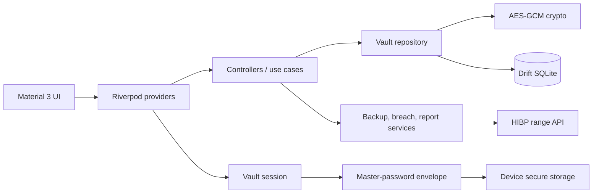
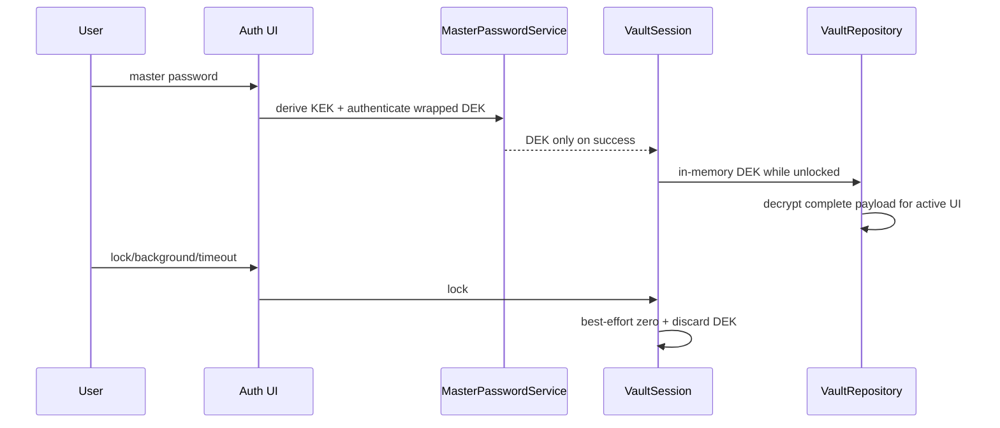

# Architecture

CyVault uses feature-first clean boundaries without turning a graduation project
into a framework. Riverpod is the only state/dependency system; go_router is the
only router. Widgets call controllers, controllers call repositories/services,
and domain code does not import widgets.

This document describes the shipped offline v1 architecture. The proposed v2
Google identity, encrypted synchronization, and sharing boundaries are recorded
in [ADR-002](adr/ADR-002-google-auth-encrypted-sync.md) and
[ADR-003](adr/ADR-003-sharing-cryptography.md); they are not shipped features
until their implementation PRs pass their separate gates.

## Data lifecycle

`VaultController` keeps decrypted entries only while the session is unlocked and
clears them when session state changes. Search/reuse analysis is deliberately
in-memory. Database rows keep only ciphertext plus non-sensitive operational
metadata needed for migration/sorting/risk display.

## Routing and adaptive UI

The router redirects locked users to `/auth` and unlocked users away from it.
Secondary routes share the same guard. The shell uses a phone `NavigationBar`
and a `NavigationRail` from 760 logical pixels. RTL comes from generated locale
delegates; code uses directional positioning instead of hard-coded left/right.

## Dependency choices

- Drift provides typed schema/migrations and background native SQLite opening.
- `cryptography` provides PBKDF2, HMAC, SHA-1 (HIBP only) and AES-GCM.
- Dynamic color is pinned to 1.9.0 because its 2.x line targets the separate
  `material_ui` type system, incompatible with this verified Flutter template.
- Direct versions are pinned and `pubspec.lock` is committed.
